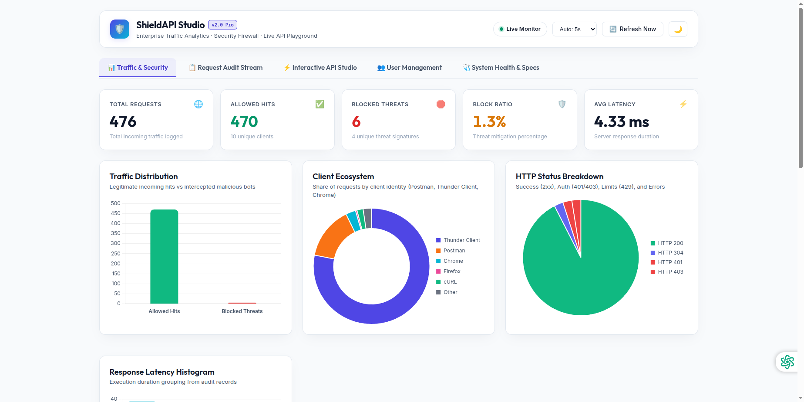
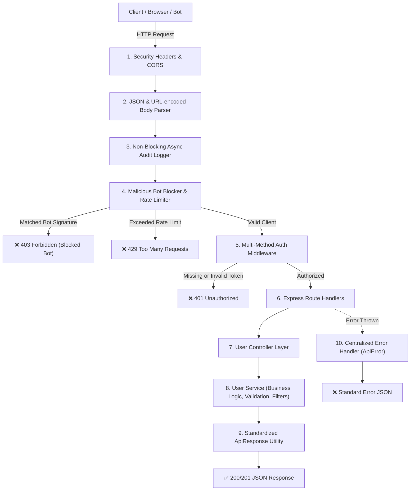

<div align="center">

# 🛡️ Enterprise Secure User Management REST API & Studio

**A production-ready, ultra-secure, modular REST API and interactive analytics & management studio built with Node.js & Express.js**
Layered Architecture · Bot & Threat Blocker · Flexible Token & Key Auth · Safe Rolling Audit Logger · Interactive API Studio · User Management GUI · Live Analytics

<br />


<br />

[Features](#-features) · [Interactive Studio](#-live-analytics--api-studio) · [Architecture](#-architecture--request-flow) · [Getting Started](#-getting-started) · [API Reference](#-api-reference) · [Security](#-security-implementation)

<br />



<sub>The built-in live dashboard and API testing suite at <code>/dashboard</code>.</sub>

</div>

---

## 📑 Table of Contents

- [✨ Features](#-features)
- [📊 Live Analytics & API Studio](#-live-analytics--api-studio)
- [🏗️ Architecture & Request Flow](#-architecture--request-flow)
- [📂 Project Structure](#-project-structure)
- [🛠️ Tech Stack](#-tech-stack)
- [🚀 Getting Started](#-getting-started)
- [📡 API Reference](#-api-reference)
- [🧪 Request & Response Examples](#-request--response-examples)
- [🛡️ Security Implementation](#-security-implementation)
- [⚙️ Environment Configuration](#️-environment-configuration)

---

## ✨ Features

|     | Layer / Feature             | Implementation                                                        | Purpose                                                                                          |
| :-: | :-------------------------- | :-------------------------------------------------------------------- | :----------------------------------------------------------------------------------------------- |
| 🚦  | **Rate Limiting**           | [`express-rate-limit`](https://www.npmjs.com/package/express-rate-limit) | Stops brute-force, scraping and DDoS attempts (configurable window & max hits per IP).           |
| 🤖  | **Bot & Scanner Blocker**   | Regex blocklist (`middleware/user.js`)                                | Rejects malicious clients such as `sqlmap`, `nmap`, `nikto`, `curl`, `python-requests`.           |
| 📝  | **Safe Audit Logging**      | Non-blocking rolling buffer (`middleware/Audit/auditLogger.js`)        | Persists client hits to `loges/request.json` with rolling buffer cap and IP normalization.        |
| 🔑  | **Multi-Method Auth**       | Custom token validator (`isValid`)                                    | Supports `Authorization: Bearer <token>`, `x-api-key` header, or `?token=<token>` query param.   |
| ⚡  | **Interactive API Studio**  | Built-in Postman-like tester (`/dashboard`)                           | Send live GET/POST/PUT/DELETE requests directly in browser with headers, body and instant feedback.|
| 👥  | **User Management GUI**     | Visual CRUD Studio (`/dashboard`)                                     | View, search, add, edit, and delete users visually in real-time.                                  |
| 📈  | **Analytics & Health**      | `/dashboard`, `/api/analytics`, `/api/health`                         | Live charts, status codes breakdown, latency histograms, memory/CPU metrics, and export tools.    |
| 🧯  | **Enterprise Errors**       | Centralized Error Handler (`middleware/errorHandler.js`)              | Standard JSON responses with `ApiError` class and 404 handler for unknown routes.                |

---

## 📊 Live Analytics & API Studio

Open **`http://localhost:3000/dashboard`** to access the complete management suite:

1. **Traffic & Security Overview**:
   - Total requests, allowed hits, blocked bots, and threat block ratio.
   - Traffic distribution bar chart & client ecosystem donut chart.
   - HTTP status code breakdown pie chart (200, 401, 403, 429, 500).
   - Latency distribution histogram (<10ms, 10-50ms, 50-200ms, >200ms).
   - Allowed clients and blocked threats filterable data tables.

2. **Request Audit Stream**:
   - Live stream of all requests from `loges/request.json`.
   - Filter by HTTP method (`GET`, `POST`, `PUT`, `DELETE`) or status code.
   - Export audit logs as **JSON** or **CSV** with one click.
   - Clear/prune audit logs directly from the UI.

3. **Interactive API Studio**:
   - Built-in Postman/Swagger-like testing tool.
   - Pre-configured presets for all endpoints.
   - Custom headers, auth tokens, and JSON request payload editor with syntax prettifier.
   - Color-coded status badges, response durations in ms, and 1-click clipboard copy.

4. **User Management Studio**:
   - Live visual directory of users.
   - Search by name or email; filter by role (`admin`, `editor`, `user`).
   - "Add New User" modal with client & server validation.
   - "Edit User" and "Delete User" modal actions with instantaneous updates.

5. **System Health & Server Specs**:
   - Node process uptime clock.
   - Memory RSS, Heap Total, and Heap Used live gauges.
   - Route directory and API endpoints catalog.

---

## 🏗️ Architecture & Request Flow



---

## 📂 Project Structure

```plaintext
API-Part-2/
├── config/
│   └── index.js             # Centralized configuration (Port, tokens, rate limits, env)
├── controllers/
│   └── userControllers.js   # Request parsing, service orchestration & response formatting
├── middleware/
│   ├── Audit/
│   │   └── auditLogger.js   # Non-blocking async rolling-buffer request audit logger
│   ├── user.js              # Multi-channel token validation & bot blocker
│   ├── errorHandler.js      # Global centralized error handler
│   └── notFound.js          # Clean 404 JSON response handler
├── router/
│   └── user.js              # REST endpoints routing definitions
├── services/
│   └── userservices.js      # Core business logic: pagination, searching, sorting, CRUD, stats
├── utils/
│   ├── apiError.js          # Custom operational ApiError class
│   ├── apiResponse.js       # Standardized JSON response envelope helper
│   └── logger.js            # Normalized IP persistence for userAgent.json & blocked.json
├── public/
│   ├── dashboard.html       # State-of-the-art Analytics & API Studio GUI
│   └── dashboard.png        # Dashboard preview
├── loges/
│   └── request.json         # Rolling audit log entries
├── userAgent.json           # Tracked legitimate clients and counts
├── blocked.json             # Tracked blocked bots and patterns
├── .env                     # Local environment variables
├── .env.example             # Environment template
├── app.js                   # Application bootstrap & middleware pipeline
├── package.json             # Project dependencies & scripts
└── README.md                # Comprehensive documentation
```

---

## 🛠️ Tech Stack

| Category          | Technology                                                     | Purpose                                       |
| :---------------- | :------------------------------------------------------------- | :-------------------------------------------- |
| **Runtime**       | [Node.js](https://nodejs.org/) (v18+)                          | Fast JavaScript backend engine                |
| **Framework**     | [Express.js](https://expressjs.com/) (v5.x)                   | Scalable REST API framework                   |
| **Security**      | Custom Blocklist + [CORS](https://www.npmjs.com/package/cors)  | Threat interception & cross-origin control    |
| **Rate Limiter**  | [express-rate-limit](https://www.npmjs.com/package/express-rate-limit) | DoS and brute-force mitigation                |
| **Configuration** | [dotenv](https://www.npmjs.com/package/dotenv)                | 12-Factor app environment configuration       |
| **Frontend GUI**  | HTML5, Vanilla CSS, Chart.js, Google Fonts                     | Modern, zero-dependency, ultra-fast studio UI |

---

## 🚀 Getting Started

### 1. Clone & Install Dependencies

```bash
git clone https://github.com/your-username/API-Part-2.git
cd API-Part-2
npm install
```

### 2. Configure Environment

Copy `.env.example` to `.env`:

```bash
cp .env.example .env
```

Default settings in `.env`:
```env
PORT=3000
NODE_ENV=development
API_TOKENS=123,dev-secret-token,admin-master-key
RATE_LIMIT_WINDOW_MS=1000
RATE_LIMIT_MAX=5
MAX_AUDIT_LOGS=1000
CORS_ORIGIN=*
```

### 3. Run the Server

```bash
# Development (with nodemon auto-restart)
npm run dev

# Production
npm start
```

Open **`http://localhost:3000/dashboard`** to explore the dashboard and test the endpoints!

---

## 📡 API Reference

All protected `/api/users` endpoints accept authentication through any of the following:
- Header: `Authorization: Bearer 123`
- Header: `x-api-key: 123`
- Query param: `?token=123`

### 1. System & Analytics Endpoints

| Method | Endpoint                 | Protection | Description                                        |
| :----- | :----------------------- | :--------- | :------------------------------------------------- |
| `GET`  | `/`                      | Public     | API welcome metadata & route catalog               |
| `GET`  | `/dashboard`             | Public     | Web Studio & Analytics GUI                         |
| `GET`  | `/api/health`            | Firewall   | Node.js memory, uptime & system health status      |
| `GET`  | `/api/analytics`         | Firewall   | Metrics, status breakdown & client activity stats  |
| `POST` | `/api/analytics/clear`   | Firewall   | Clear/prune audit request logs                     |
| `GET`  | `/api/analytics/export`  | Firewall   | Download logs as CSV (`?format=csv`) or JSON       |

### 2. User Management Endpoints

| Method   | Endpoint           | Protection | Query Parameters                                           | Description                                  |
| :------- | :----------------- | :--------- | :--------------------------------------------------------- | :------------------------------------------- |
| `GET`    | `/api/users`       | Token      | `page`, `limit`, `search`, `role`, `status`, `sortBy`, `sortOrder` | List users with pagination, search & sorting |
| `GET`    | `/api/users/stats` | Token      | None                                                       | Aggregated user metrics & role breakdown     |
| `GET`    | `/api/users/:id`   | Token      | None                                                       | Retrieve individual user by ID               |
| `POST`   | `/api/users`       | Token      | None                                                       | Create new user (name, email, role, status)  |
| `PUT`    | `/api/users/:id`   | Token      | None                                                       | Update user attributes                       |
| `DELETE` | `/api/users/:id`   | Token      | None                                                       | Delete user by ID                            |

---

## 🧪 Request & Response Examples

### Querying Users with Filtering & Pagination

```bash
curl -X GET "http://localhost:3000/api/users?search=farhan&role=admin&page=1&limit=10" \
  -H "Authorization: Bearer 123"
```

**Response (HTTP 200 OK):**
```json
{
  "success": true,
  "statusCode": 200,
  "message": "Users retrieved successfully",
  "data": [
    {
      "id": 1,
      "name": "Aftab Farhan",
      "email": "farhan@example.com",
      "role": "admin",
      "status": "active",
      "createdAt": "2026-01-10T10:00:00.000Z",
      "updatedAt": "2026-01-10T10:00:00.000Z"
    }
  ],
  "meta": {
    "total": 1,
    "page": 1,
    "limit": 10,
    "totalPages": 1,
    "hasNextPage": false,
    "hasPrevPage": false
  }
}
```

### Creating a New User

```bash
curl -X POST "http://localhost:3000/api/users" \
  -H "Authorization: Bearer 123" \
  -H "Content-Type: application/json" \
  -d '{
    "name": "Tamim Iqbal",
    "email": "tamim@example.com",
    "role": "editor"
  }'
```

**Response (HTTP 201 Created):**
```json
{
  "success": true,
  "statusCode": 201,
  "message": "User created successfully",
  "data": {
    "id": 5,
    "name": "Tamim Iqbal",
    "email": "tamim@example.com",
    "role": "editor",
    "status": "active",
    "createdAt": "2026-10-19T21:15:00.000Z",
    "updatedAt": "2026-10-19T21:15:00.000Z"
  }
}
```

---

## 🛡️ Security Implementation

1. **IP Sanitization**: Normalizes all incoming IP addresses, stripping IPv4-mapped IPv6 prefixes (`::ffff:`) and resolving local loopbacks cleanly.
2. **Bot & Vulnerability Scanner Blocker**: Automatically inspects `User-Agent` headers against known scanner signatures (`sqlmap`, `nmap`, `nikto`, `acunetix`, `curl`, `python-requests`, etc.) and returns an HTTP 403 Forbidden with security logging.
3. **Safe Rolling Audit Logging**: Avoids memory and disk spikes by batching and bounding log entries (`MAX_AUDIT_LOGS=1000`) so long-running servers stay fast.
4. **Header Redaction**: Sensitive headers such as `Authorization`, `x-api-key`, and `cookie` are automatically redacted before logging to disk.
5. **Standardized Error Masking**: Stack traces are masked in production mode (`NODE_ENV=production`) while maintaining clean operational JSON error responses.

---

<div align="center">
  <b>ShieldAPI Studio · Built for High-Performance Enterprise Node.js Applications</b>
</div>
