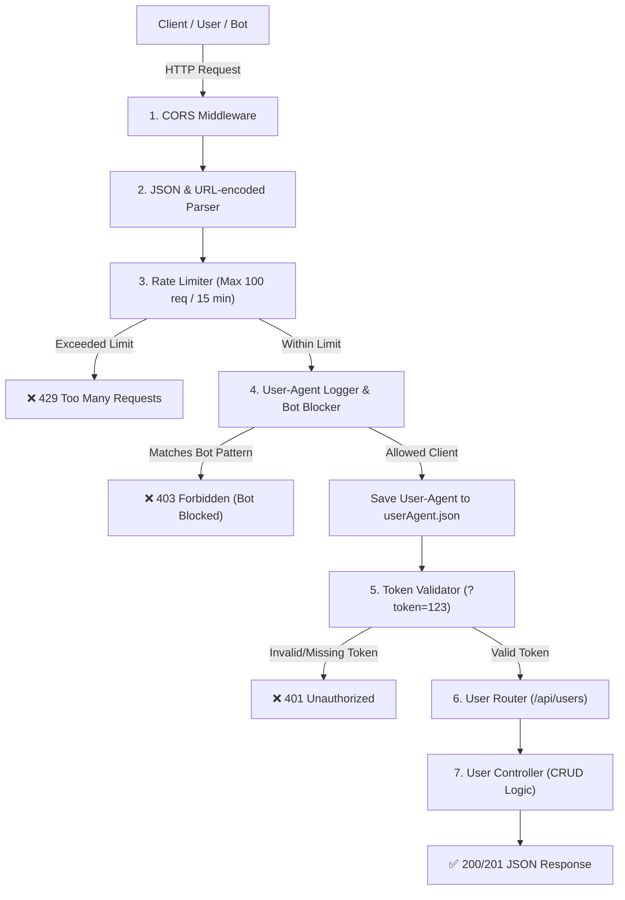

# 🛡️ Secure User Management REST API (Express.js)

A production-ready, secure, and modular RESTful API built with **Node.js** and **Express.js**, following clean **MVC (Model-View-Controller)** principles. This API features **DDoS protection via rate limiting**, **malicious bot blocking**, **automated User-Agent logging**, **token validation**, and **CORS**.

---

## 🏗️ Architecture & Request Flow



---

## ✨ Features & Security Layers

| Security Layer | Technology / Implementation | Purpose |
| :--- | :--- | :--- |
| **Rate Limiting** | [`express-rate-limit`](https://www.npmjs.com/package/express-rate-limit) | Prevents brute-force, scraping, and DDoS attacks (100 req / 15 min). |
| **Bot & Scanner Blocker** | Regex Blocklist (`middleware/user.js`) | Rejects malicious scrapers (`sqlmap`, `nmap`, `python-requests`, etc.). |
| **Audit Logging** | File I/O Logger (`utils/logger.js`) | Automatically logs every client's `User-Agent` to `userAgent.json`. |
| **Token Authentication** | Custom Middleware (`isValid`) | Protects endpoints via query authentication (`?token=123`). |
| **CORS Protection** | [`cors`](https://www.npmjs.com/package/cors) | Controls cross-origin resource access. |
| **Error Handling** | Global Handlers | Graceful JSON responses for 400, 401, 403, 404, 429, and 500. |

---

## 📂 Project Directory Structure

```plaintext
API-Part-2/
├── controllers/
│   └── userControllers.js   # Business logic, CRUD operations, & mock dataset
├── middleware/
│   └── user.js              # Token validator & Bot-blocking User-Agent middleware
├── router/
│   └── user.js              # Express routing definitions
├── utils/
│   └── logger.js            # User-Agent persistence utility
├── userAgent.json           # Log file tracking all incoming request clients
├── app.js                   # Application bootstrap, security layers, & server entry
├── package.json             # NPM dependencies, metadata, and scripts
├── .gitignore               # Excluded files (node_modules, environment files)
└── README.md                # Comprehensive documentation
```

---

## 🛠️ Tech Stack & Dependencies

- **Runtime**: [Node.js](https://nodejs.org/) (v18+)
- **Framework**: [Express.js](https://expressjs.com/) (v5.x)
- **Rate Limiting**: `express-rate-limit` (v8.x)
- **CORS Handling**: `cors` (v2.x)
- **Development Tool**: `nodemon` (v3.x)

---

## 🚀 Getting Started

### Prerequisites

Make sure you have **Node.js** and **npm** installed:
```bash
node -v
npm -v
```

### 1. Installation

Clone repository and install dependencies:
```bash
git clone <repository-url>
cd API-Part-2
npm install
```

### 2. Running the Server

#### Development Mode (Auto-restart on file save):
```bash
npm run dev
```

#### Production Mode:
```bash
npm start
```

The server will be available at: **`http://localhost:3000`**

---

## 📡 API Endpoints

> **Note**: All user endpoints require the authentication query parameter: **`?token=123`**

| Method | Endpoint | Description | Request Body | Auth Required |
| :--- | :--- | :--- | :--- | :--- |
| **GET** | `/` | Health check / Server status | None | No |
| **GET** | `/dashboard` | Interactive Web Dashboard (Charts & Analytics) | None | No |
| **GET** | `/api/analytics` | Analytics JSON API for Allowed vs Blocked data | None | No |
| **GET** | `/api/users?token=123` | Retrieve all users | None | Yes |
| **GET** | `/api/users/:id?token=123` | Retrieve user by ID | None | Yes |
| **POST** | `/api/users?token=123` | Create a new user | JSON (`name`, `email`, `role`) | Yes |
| **PUT** | `/api/users/:id?token=123` | Update user by ID | JSON (`name`, `email`, `role`) | Yes |
| **DELETE**| `/api/users/:id?token=123` | Delete user by ID | None | Yes |

---

## 🧪 Request & Response Examples

### 1. Successful User Creation (`POST /api/users?token=123`)

**Request:**
```http
POST http://localhost:3000/api/users?token=123
Content-Type: application/json

{
  "name": "Aftab Farhan",
  "email": "farhan@example.com",
  "role": "admin"
}
```

**Response (`201 Created`):**
```json
{
  "success": true,
  "message": "User created successfully",
  "data": {
    "id": 5,
    "name": "Aftab Farhan",
    "email": "farhan@example.com",
    "role": "admin"
  }
}
```

---

### 2. Rate Limit Exceeded (`429 Too Many Requests`)
Triggered if an IP exceeds **100 requests within 15 minutes**:

```json
{
  "success": false,
  "message": "Too many requests from this IP, please try again after 15 minutes"
}
```

---

### 3. Malicious Bot Blocked (`403 Forbidden`)
Triggered if the `User-Agent` matches patterns like `python-requests`, `sqlmap`, `nmap`, etc.:

```json
{
  "success": false,
  "message": "Access Denied: Your client is blocked"
}
```

---

### 4. Missing / Invalid Token (`401 Unauthorized`)
Triggered if `?token=123` is missing:

```json
{
  "message": "Unauthorized: Invalid token"
}
```

---

## 🛡️ Security Implementation Details

### Rate Limiter Configuration (`app.js`)
```javascript
const { rateLimit } = require("express-rate-limit");

const limiter = rateLimit({
  windowMs: 15 * 60 * 1000, // 15-minute window
  limit: 100,               // Max 100 requests per IP
  standardHeaders: "draft-8",
  legacyHeaders: false,
  message: {
    success: false,
    message: "Too many requests from this IP, please try again after 15 minutes",
  },
});

app.use(limiter);
```

### Bot Blocker Regex List (`middleware/user.js`)
```javascript
const blockedPatterns = [
  /python-requests/i,
  /Go-http-client/i,
  /Java/i,
  /sqlmap/i,
  /nmap/i,
  /Nikto/i,
  /HeadlessChrome/i,
  /PhantomJS/i,
];
```

---

## 👨‍💻 Author

Developed by **Aftab Farhan**
