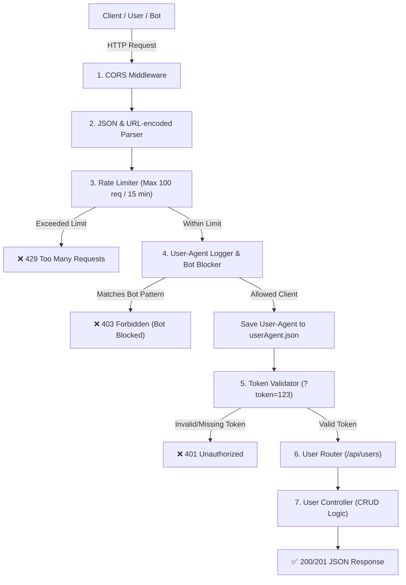

<div align="center">

# 🛡️ Secure User Management REST API

**A production-ready, secure and modular REST API built with Node.js & Express.js**
Rate limiting · Bot blocking · User-Agent auditing · Token auth · Live analytics dashboard

<br />


<br />

[Features](#-features) · [Dashboard](#-live-analytics-dashboard) · [Architecture](#-architecture--request-flow) · [Getting Started](#-getting-started) · [API Reference](#-api-reference) · [Security](#-security-implementation)

<br />


<sub>The built-in live dashboard at <code>/dashboard</code>, auto-refreshing every 5 seconds.</sub>

</div>

---

## 📑 Table of Contents

- [✨ Features](#-features)
- [📊 Live Analytics Dashboard](#-live-analytics-dashboard)
- [🏗️ Architecture & Request Flow](#-architecture--request-flow)
- [📂 Project Structure](#-project-structure)
- [🛠️ Tech Stack](#-tech-stack)
- [🚀 Getting Started](#-getting-started)
- [📡 API Reference](#-api-reference)
- [🧪 Request & Response Examples](#-request--response-examples)
- [🛡️ Security Implementation](#-security-implementation)
- [⚠️ Production Notes](#-production-notes)
- [👨‍💻 Author](#-author)

---

## ✨ Features

|     | Security Layer            | Implementation                                                           | Purpose                                                                                          |
| :-: | :------------------------ | :----------------------------------------------------------------------- | :----------------------------------------------------------------------------------------------- |
| 🚦  | **Rate Limiting**         | [`express-rate-limit`](https://www.npmjs.com/package/express-rate-limit) | Stops brute-force, scraping and DDoS attempts (100 req / 15 min per IP).                         |
| 🤖  | **Bot & Scanner Blocker** | Regex blocklist (`middleware/user.js`)                                   | Rejects malicious clients such as `sqlmap`, `nmap`, `python-requests`.                           |
| 📝  | **Audit Logging**         | File logger (`utils/logger.js`)                                          | Persists every client's `User-Agent` to `userAgent.json`; blocked attempts go to `blocked.json`. |
| 🔑  | **Token Authentication**  | Custom middleware (`isValid`)                                            | Protects user endpoints through query authentication (`?token=123`).                             |
| 🌐  | **CORS Protection**       | [`cors`](https://www.npmjs.com/package/cors)                             | Controls cross-origin resource access.                                                           |
| 📈  | **Analytics Dashboard**   | `/dashboard` + `/api/analytics`                                          | Live charts of allowed vs blocked traffic and per-client breakdown.                              |
| 🧯  | **Error Handling**        | Global handlers                                                          | Clean JSON responses for `400`, `401`, `403`, `404`, `429` and `500`.                            |

---

## 📊 Live Analytics Dashboard

Open **`http://localhost:3000/dashboard`** to watch your traffic in real time. The page reads from `userAgent.json` and `blocked.json` and refreshes every **5 seconds** (or instantly with **Refresh now**).

<div align="center">
  
</div>

<br />

| Widget                         | What it shows                                                                         |
| :----------------------------- | :------------------------------------------------------------------------------------ |
| **Total requests**             | Combined count of allowed and blocked requests, with a ratio bar.                     |
| **Allowed**                    | Legitimate requests and the number of unique clients.                                 |
| **Blocked**                    | Blocked attempts and the number of unique bots.                                       |
| **Block rate**                 | Blocked requests as a share of all traffic.                                           |
| **Allowed vs blocked**         | Bar chart comparing legitimate hits with blocked attempts.                            |
| **Allowed requests by client** | Donut chart of hits per client type (Thunder Client, Postman, Chrome, Firefox, cURL). |
| **Client breakdown**           | Hits per `User-Agent` with percentage share and source IP.                            |

> 💡 The raw data behind the dashboard is available as JSON at `GET /api/analytics`.

---

## 🏗️ Architecture & Request Flow

Every request passes through a layered pipeline before it reaches your business logic.



---

## 📂 Project Structure

```plaintext
API-Part-2/
├── controllers/
│   └── userControllers.js   # Business logic, CRUD operations & mock dataset
├── middleware/
│   └── user.js              # Token validator & bot-blocking User-Agent middleware
├── router/
│   └── user.js              # Express routing definitions
├── utils/
│   └── logger.js            # User-Agent persistence utility
├── public/
│   ├── dashboard.html       # Live analytics dashboard
│   └── dashboard.png        # Dashboard screenshot displayed in this README
├── userAgent.json           # Log of all allowed request clients
├── blocked.json             # Log of blocked bots and scanners
├── app.js                   # Application bootstrap, security layers & server entry
├── package.json             # Dependencies, metadata and scripts
├── .gitignore               # Excluded files (node_modules, environment files)
└── README.md                # Documentation
```

---

## 🛠️ Tech Stack

| Category          | Technology                           | Version |
| :---------------- | :----------------------------------- | :------ |
| **Runtime**       | [Node.js](https://nodejs.org/)       | 18+     |
| **Framework**     | [Express.js](https://expressjs.com/) | 5.x     |
| **Rate Limiting** | `express-rate-limit`                 | 8.x     |
| **CORS Handling** | `cors`                               | 2.x     |
| **Dev Tooling**   | `nodemon`                            | 3.x     |

---

## 🚀 Getting Started

### Prerequisites

Make sure **Node.js** and **npm** are installed:

```bash
node -v
npm -v
```

### 1. Installation

```bash
git clone <repository-url>
cd API-Part-2
npm install
```

### 2. Run the server

```bash
# Development: auto-restart on file save
npm run dev

# Production
npm start
```

The server is now available at **`http://localhost:3000`**.

### 3. Quick smoke test

```bash
# Health check
curl http://localhost:3000/

# Fetch all users (token required)
curl "http://localhost:3000/api/users?token=123"
```

Then open **`http://localhost:3000/dashboard`** to see your requests appear live.

---

## 📡 API Reference

> **Note:** All `/api/users` endpoints require the query parameter **`?token=123`**.

|  Method  | Endpoint                   | Description                                    | Request Body                   | Auth |
| :------: | :------------------------- | :--------------------------------------------- | :----------------------------- | :--: |
|  `GET`   | `/`                        | Health check / server status                   | None                           |  ❌  |
|  `GET`   | `/dashboard`               | Interactive web dashboard (charts & analytics) | None                           |  ❌  |
|  `GET`   | `/api/analytics`           | Analytics JSON for allowed vs blocked traffic  | None                           |  ❌  |
|  `GET`   | `/api/users?token=123`     | Retrieve all users                             | None                           |  ✅  |
|  `GET`   | `/api/users/:id?token=123` | Retrieve a user by ID                          | None                           |  ✅  |
|  `POST`  | `/api/users?token=123`     | Create a new user                              | JSON (`name`, `email`, `role`) |  ✅  |
|  `PUT`   | `/api/users/:id?token=123` | Update a user by ID                            | JSON (`name`, `email`, `role`) |  ✅  |
| `DELETE` | `/api/users/:id?token=123` | Delete a user by ID                            | None                           |  ✅  |

### Status codes

| Code  | Meaning           | Triggered when                              |
| :---: | :---------------- | :------------------------------------------ |
| `200` | OK                | Request succeeded.                          |
| `201` | Created           | A new user was created.                     |
| `401` | Unauthorized      | Token is missing or invalid.                |
| `403` | Forbidden         | `User-Agent` matches the bot blocklist.     |
| `404` | Not Found         | Route or user does not exist.               |
| `429` | Too Many Requests | IP exceeded 100 requests in 15 minutes.     |
| `500` | Server Error      | Unexpected failure, returned as clean JSON. |

---

## 🧪 Request & Response Examples

<details open>
<summary><b>✅ 1. Successful user creation</b> <code>POST /api/users?token=123</code></summary>

<br />

**Request**

```http
POST http://localhost:3000/api/users?token=123
Content-Type: application/json

{
  "name": "Aftab Farhan",
  "email": "farhan@example.com",
  "role": "admin"
}
```

**Response** `201 Created`

```json
{
  "success": true,
  "message": "User created successfully",
  "data": {
    "id": 5,
    "name": "Aftab Farhan",
    "email": "farhan@example.com",
    "role": "admin"
  }
}
```

</details>

<details>
<summary><b>🚦 2. Rate limit exceeded</b> <code>429 Too Many Requests</code></summary>

<br />

Triggered when an IP exceeds **100 requests within 15 minutes**:

```json
{
  "success": false,
  "message": "Too many requests from this IP, please try again after 15 minutes"
}
```

</details>

<details>
<summary><b>🤖 3. Malicious bot blocked</b> <code>403 Forbidden</code></summary>

<br />

Triggered when the `User-Agent` matches patterns like `python-requests`, `sqlmap` or `nmap`:

```json
{
  "success": false,
  "message": "Access Denied: Your client is blocked"
}
```

</details>

<details>
<summary><b>🔑 4. Missing or invalid token</b> <code>401 Unauthorized</code></summary>

<br />

Triggered when `?token=123` is missing or wrong:

```json
{
  "message": "Unauthorized: Invalid token"
}
```

</details>

---

## 🛡️ Security Implementation

### Rate limiter configuration (`app.js`)

```javascript
const { rateLimit } = require("express-rate-limit");

const limiter = rateLimit({
  windowMs: 15 * 60 * 1000, // 15-minute window
  limit: 100, // Max 100 requests per IP
  standardHeaders: "draft-8",
  legacyHeaders: false,
  message: {
    success: false,
    message:
      "Too many requests from this IP, please try again after 15 minutes",
  },
});

app.use(limiter);
```

### Bot blocker regex list (`middleware/user.js`)

```javascript
const blockedPatterns = [
  /python-requests/i,
  /Go-http-client/i,
  /Java/i,
  /sqlmap/i,
  /nmap/i,
  /Nikto/i,
  /HeadlessChrome/i,
  /PhantomJS/i,
];
```

---

## ⚠️ Production Notes

This project is a solid security foundation, but before exposing it publicly consider these hardening steps:

- **Move the token out of the URL.** Query-string tokens can leak into logs and browser history. Prefer an `Authorization: Bearer <token>` header, ideally with JWT.
- **Load secrets from environment variables** (for example with `dotenv`) instead of hard-coding `123`.
- **Restrict CORS origins** to your own frontend domains instead of allowing every origin.
- **Treat `User-Agent` blocking as one layer, not the only one.** The header is easy to spoof, so keep rate limiting and authentication in place.
- **Persist data in a real database** instead of the in-memory mock dataset.

---

## 👨‍💻 Author

<div align="center">

Developed with ❤️ by **Aftab Farhan**

⭐ If you found this project useful, consider giving it a star!

</div>
